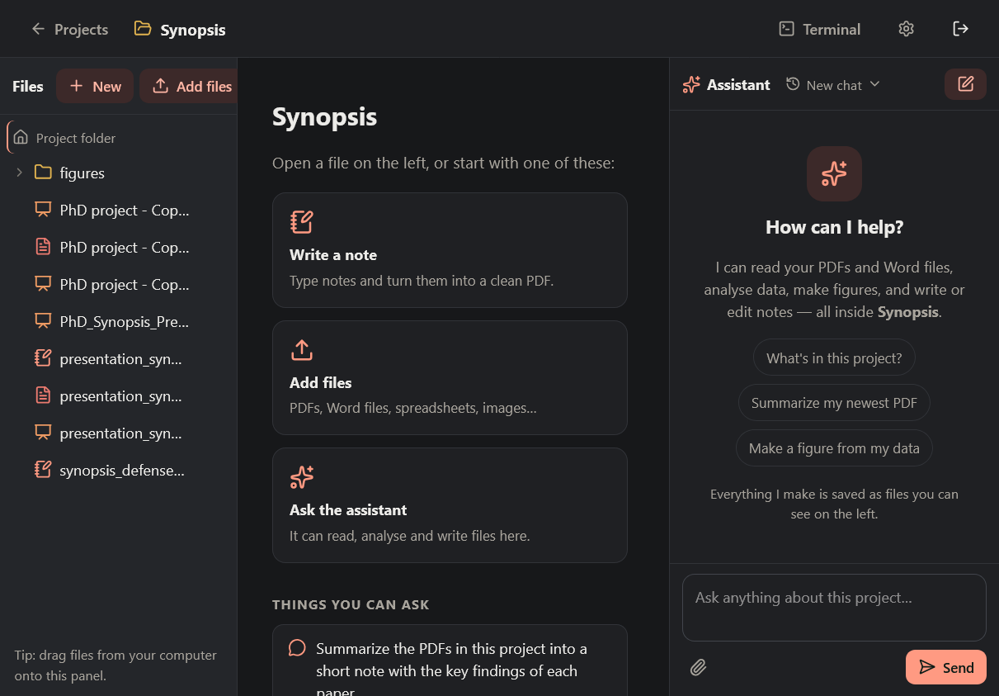

#  Pokosomo Studio

**A ready-made AI lab assistant for scientists who don't code.**

Programmers already have powerful AI agents that read files, run analyses and write code, but those
tools assume you live in a terminal and can set up Python, R and LaTeX yourself. Pokosomo puts the
same kind of agent in a sealed box with everything a researcher needs already installed. You add
it with a double-click and use it in your browser.

It was built for friends in **medical research**: people who are experts in their field, have
spreadsheets of plate counts, growth curves and qPCR results, and a folder of papers to get through,
but no time or wish to learn programming.



## What makes it different

**A chatbot gives you text to copy and paste. Pokosomo hands you finished files.**

| In a chatbot website | In Pokosomo |
|---|---|
| You upload a file, it describes it | It opens your actual files and works on them where they are |
| It suggests Python code you'd have to run yourself | It runs the analysis itself and gives you the results, the figure and the script |
| You copy its answer into Word | It writes the note, PDF or Word file into your project |
| Each conversation starts from nothing | Each project keeps its files and its chat history together |
| You set up the tools, or do without | R, Python, LaTeX, OCR and Office conversion are already inside |

- **Made for a scientist, not a developer.** The assistant is told that you're an expert in your
  field but not a programmer. It replies in plain language, shows its results as files you can open,
  and doesn't send you off to run commands.
- **Careful with your science.** It saves every analysis as a script so it can be re-run and checked.
  It checks the assumptions before choosing a statistical test, and it's told never to invent data
  or references.
- **Ready for lab data.** It comes with Python (pandas, SciPy, statsmodels, pingouin, scikit-posthocs,
  lifelines, Biopython, scikit-bio) and R, so growth curves, group comparisons, survival curves,
  sequence files and diversity measures work straight away. It can install anything else it needs.
- **Ready for writing.** Notes become typeset PDFs (LaTeX, with references) or Word files with one
  click. Scanned papers are made searchable with OCR, and Word and PowerPoint files can be previewed
  and turned into notes.
- **Contained.** The assistant works inside its own container. It can reach only the Pokosomo folder,
  not the rest of your computer, and it's told to stay inside the project you have open. Deleted
  files go to a trash folder instead of disappearing.
- **Uses the subscription you already have.** Connect Claude, ChatGPT (Codex) or Google
  (Antigravity). You don't need API keys or a separate bill, and you can switch between them in
  Settings.
- **Your files stay yours.** Each project is an ordinary folder on your computer that you can back
  up or open in other programs. It runs on a laptop, a lab server or a VPS, and on a phone the three
  panels become tabs.

## What you need

- **Windows 10/11** or **Linux**, with about **20 GB of free disk space**. The first start
  downloads about 10 GB.
- **An account with at least one AI provider:** a Claude subscription, a ChatGPT plan that includes
  Codex, or a Google account for Antigravity.
- **A container program**, which keeps all the tools in one tidy box:
  - Windows: [Docker Desktop](https://www.docker.com/products/docker-desktop/) (easiest), or
    [WSL containers](https://learn.microsoft.com/en-us/windows/wsl/wsl-container) if you prefer not to
    install Docker.
  - Linux: [Docker Engine with the Compose plugin](https://docs.docker.com/engine/install/).

## Get it working on Windows

1. **Install [Docker Desktop](https://www.docker.com/get-started/)** and open it. Wait until it says the engine is running.
2. **Download Pokosomo**: on the GitHub page, click **Code → Download ZIP**, then extract the ZIP
   wherever you want to keep your projects (for example, `Documents\Pokosomo`).
3. Open the `windows` folder and **double-click `start.bat`**. The first time, it:
   - asks you to accept the license terms (it's free software with no warranty, see [License](#license))
   - downloads the ready-made studio (this takes a while the first time)
   - asks you to **choose a password** for the studio
   - asks whether to turn on **two-factor sign-in**. Say no if you only use it on your own laptop.
     Say yes if other people or the internet can reach it (see [Keeping it safe](#keeping-it-safe)).
   - offers to **connect your AI account**. Choose Claude, Codex or Antigravity and follow the
     steps on screen.
4. Your browser opens at **http://localhost:8001**. Sign in with your password.
5. Open **Settings** (the gear icon) and choose which assistant to use.

**Stopping and starting:** double-click `windows\stop.bat` to stop and `windows\start.bat` to start
again. With WSL containers, keep the start window open while you work and close it to stop. Your
projects and sign-ins are kept either way.

**Connecting another AI account later:** double-click `windows\setup-agent.bat`.

## Get it working on Linux

Open a terminal and run:

```bash
git clone https://github.com/tabahi/pokosomo.git
cd pokosomo
./linux/start.sh
```

It goes through the same steps as on Windows: license, download, password, optional two-factor
sign-in, and connecting your AI account. Then open **http://localhost:8001**.

- Stop with `./linux/stop.sh` and start again with `./linux/start.sh`.
- To connect another AI account later, run `./linux/setup-agent.sh`.
- No Docker? `start.sh` offers to install everything directly on Debian or Ubuntu instead. This also
  works on a Raspberry Pi running a 64-bit system (see [For technical users](#for-technical-users)).

## Connecting your AI account

The setup shortcut (`setup-agent.bat` or `setup-agent.sh`) asks which account to connect:

- **Claude:** open the link it shows, approve, and paste the code back.
- **OpenAI Codex:** open the link it shows and sign in with your ChatGPT account.
- **Antigravity (Google):** Antigravity opens in the window. Choose **Sign in** and open the link in
  your browser. Then paste back the code, or the address of the page you end up on. When it says
  you're signed in, type `/exit`.

**Settings → Accounts** shows which accounts are connected. Each one stays signed in until you
sign it out.

## Using the studio

1. On the home page, **create a project**. It becomes a folder inside `workspace\` in your Pokosomo
   folder.
2. **Add your files** by dragging them onto the file panel on the left.
3. **Ask the assistant** in the panel on the right. For example:
   - *"Summarise the PDFs in this project into a note with the key findings of each paper."*
   - *"Compare group A and group B in results.xlsx with a suitable test and make a figure."*
   - *"Turn draft.md into a PDF with a title page and my references."*
   - *"Proofread chapter2.docx and list the changes you made."*
   - *"Find recent papers on this topic and add them to a reading list."*
4. Click any file the assistant mentions to open it. Notes open in an editor with buttons to
   **make a PDF** or **export to Word**.

Advanced users can switch on **Settings → Advanced** to get a terminal with tabs for a shell,
Claude Code, Antigravity and Codex.

## Updating

Run `start.bat` (or `./linux/start.sh`) again. It downloads the latest version each time it starts,
and your projects, chats and sign-ins are kept. If the page looks outdated afterwards, reload it
once.

## Keeping it safe

- **Your research data:** projects are stored on your computer. When the assistant works on a
  project, your messages and the parts of files it reads are sent to the AI provider you chose
  (Anthropic, OpenAI or Google). Don't use identifiable participant data or other restricted
  information unless your institution has approved that provider.
- **The assistant can change files.** It works inside the container with full permissions, and it is
  told to stay inside the open project and never delete your files. Even so, keep backups of
  anything important.
- **On your own laptop**, a password is enough. The studio only listens on `localhost`, so other
  computers can't reach it.
- **On a server, or anywhere others can reach it**, you **must** turn on two-factor sign-in (run the
  password setup again, see below) and put it behind HTTPS.

## Troubleshooting

| Problem | What to do |
|---|---|
| `start.bat` says Docker isn't running | Open Docker Desktop, wait until the engine is running, and try again. |
| Port 8001 is already in use | Create a file named `.env` in the Pokosomo folder containing `PORT=8080`, start again, and open http://localhost:8080. |
| Forgot the studio password, or want to turn on two-factor sign-in | Stop the studio, delete `data\secrets.json` (`data/secrets.json` on Linux), and start again. It asks for a new password. Your projects are untouched. |
| The assistant says it isn't signed in | Run the setup shortcut again and connect that account. |
| A Claude, Codex or Antigravity model has run out of usage | Pick another model or assistant in **Settings**, then press **Try again**. |
| A double-clicked `.bat` window closes straight away | Open the file in Notepad and check the bottom-right corner, which should say **Windows (CRLF)**. If it says **Unix (LF)**, download the ZIP again rather than copying the files over by hand. |

## For technical users

<details>
<summary>How it's put together, host installation, security details and configuration</summary>

### How it runs

Pokosomo is a FastAPI server with a plain-JavaScript front end. The Docker image
[`where22/pokosomo-zero`](https://hub.docker.com/r/where22/pokosomo-zero) contains the server, Claude
Code, Codex, Antigravity (`agy`), TeX Live, pandoc, LibreOffice, R, OCR tools and a scientific Python
environment. [`compose.yaml`](compose.yaml) mounts `workspace/`, `tmp/` and `data/` from the
Pokosomo folder, and keeps agent sign-ins in named volumes (`codex-auth`, `claude-auth`,
`gemini-auth`). The port is published on `127.0.0.1` only.

The scripts in `windows/` are launchers: they use WSL containers (`wslc`) when available, otherwise
Docker, and run the matching script in [`windows/wslc/`](windows/wslc) or [`windows/docker/`](windows/docker).

### Host installation (no Docker)

`./linux/start.sh --host` runs [`scripts/install_deps.sh`](scripts/install_deps.sh) (Debian or
Ubuntu, needs sudo and several GB) and then [`run.sh`](run.sh). Set the password with
[`./setup_auth.sh`](setup_auth.sh). The prebuilt image is x86-64 only, so ARM machines such as a
Raspberry Pi (64-bit OS) need the host installation.

### How the agents are confined

Claude and Antigravity run with `--dangerously-skip-permissions`. Inside the container Codex runs with
`--dangerously-bypass-approvals-and-sandbox`, because its own sandbox (bubblewrap) cannot start inside
Docker. The container is the isolation boundary, and the image sets `IS_SANDBOX=1` so Claude Code
accepts this as root. In a host installation Codex uses its `workspace-write` sandbox, with
network access. All three can search and read the web.

Each agent starts in the project folder with `TMPDIR` set to `tmp/<project>/`.
[`server/agent_instructions.md`](server/agent_instructions.md) is added to its instructions: stay
inside the project, never delete files, reply in plain language, save analyses as re-runnable scripts,
and never invent data or references. Edit that file to change how the assistant behaves.

### Security details

- **Password and optional TOTP.** `data/secrets.json` (`POKOSOMO_SECRETS`) holds an scrypt hash
  of the password and, if two-factor sign-in is on, the TOTP secret. A code can't be reused, and 5
  failed attempts from one IP lock sign-in for 15 minutes.
- **Sessions** are stored on the server in `data/sessions.json` as token hashes. The cookie is
  `HttpOnly`, `SameSite=Lax`, and `Secure` over HTTPS. "Remember me" keeps you signed in for 30 days;
  without it, the cookie lasts until the browser closes and the session ends after 12 hours idle.
- Every route, static file and WebSocket needs a session, except the login page. Cross-site POSTs
  and WebSocket handshakes are rejected by an Origin check. HTML and other active content is
  download-only, and SVGs are sandboxed.
- `./setup_auth.sh logout-all` or **Settings → Sign out on all devices** revokes every session.
  Re-running the password setup also signs everyone out.
- Put HTTPS in front (Caddy, Tailscale, a Cloudflare tunnel, …) whenever the studio is reachable
  beyond localhost. Behind a proxy on another host, set `FORWARDED_ALLOW_IPS`.

### Environment variables

| Variable | Default | Purpose |
|---|---|---|
| `PORT`, `HOST` | `8001`, `0.0.0.0` | where the server listens; Docker publishes to `localhost` only |
| `FORWARDED_ALLOW_IPS` | `127.0.0.1` | proxies trusted for `X-Forwarded-*` |
| `POKOSOMO_VENV` | `.venv` | Python environment (`/opt/venv` in Docker) |
| `POKOSOMO_SECRETS`, `POKOSOMO_DATA` | `secrets.json`, `data/` | alternative locations |
| `POKOSOMO_CLAUDE_BIN`, `POKOSOMO_AGY_BIN`, `POKOSOMO_CODEX_BIN` | `claude`, `agy`, `codex` | agent executables |

### Building the image

```bash
docker build -t where22/pokosomo-zero:latest .
```

The heavy tools are installed in their own layer, so changes to the app code rebuild in seconds.

</details>

## License

Pokosomo Studio is free software under the [MIT License](LICENSE). It is provided "as is", without
warranty of any kind. The authors accept no responsibility or liability for any damage, data loss,
costs or other consequences of using it, including anything the AI assistants do. The start
scripts ask you to accept these terms once before installing.
